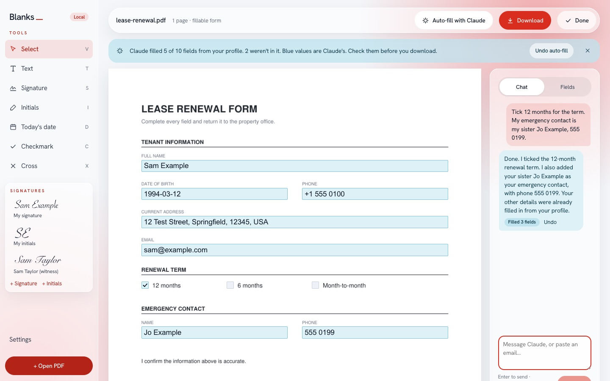
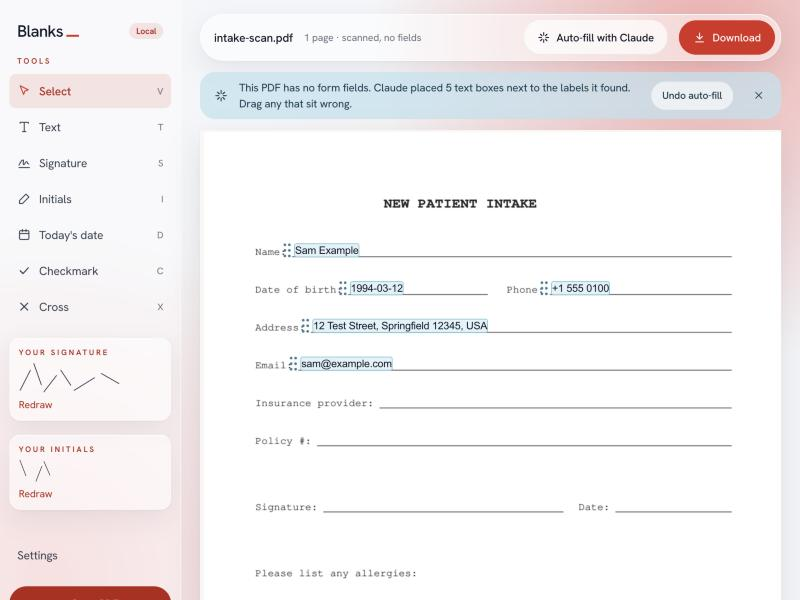

# Blanks

**Fill in the blanks.** A small app that runs on your own computer for filling in and signing PDF forms, with one-click auto-fill by Claude.



- **Fill any form.** Fillable PDFs get live inputs over their real fields. Flat and scanned PDFs work too: click anywhere and type.
- **Sign once.** Draw your signature and initials one time. Blanks saves them on your computer and reuses them on every form.
- **Stamp what forms ask for.** Today's date, checkmarks and crosses are one click each.
- **Auto-fill with Claude.** One button fills what your profile answers. It runs through your local Claude Code, so it uses your Claude subscription and needs no API key.
- **Private by default.** The server only listens on localhost. Your PDF never leaves your computer, and Blanks keeps no copy after you download.
- **Flattened output.** The downloaded PDF has everything burned into the page, so nobody can move or edit your signature.

## Quick start

You need [uv](https://docs.astral.sh/uv/) and [Node.js](https://nodejs.org/) 20 or newer. Auto-fill also needs [Claude Code](https://claude.com/claude-code), installed and signed in. Everything else works without it.

```bash
git clone https://github.com/robinlysne13/blanks-pdf.git
```

```bash
cd blanks-pdf && ./start
```

The first run builds the interface, then Blanks opens in its own window. No form handy? The start screen has three sample forms to try.

Blanks uses Chrome, Edge or Brave in app mode: a window with no tabs or address bar. Without one of those it opens a normal tab in your default browser. Add `--tab` to always use a tab.

### Keep it in the Dock (macOS)

```bash
scripts/make_mac_app.sh
```

This builds `Blanks.app` with its own icon in `~/Applications`. Open it, then right-click its Dock icon and choose Options, then Keep in Dock. Clicking it starts Blanks in the background and opens the window, with no terminal needed. The server stops by itself about ten minutes after you close the last Blanks window. The app points at this folder, so run the script again if you move it.

## Auto-fill

Blanks fills forms from a plain text profile you write yourself. Open **Settings → Profile → Create profile** and replace the placeholders:

```text
full name: Sam Example
date of birth: 1994-03-12
email: sam@example.com
```

The profile lives at `~/.blanks/profile.md`, outside the repo, so it can never be committed. Set `BLANKS_HOME` to keep it, your signature and your settings somewhere else.

**On a fillable form,** Claude gets each field's name, label and nearby printed text, and returns values only for what the profile answers. It leaves choices, agreements, signatures and signing dates for you.

**On a flat or scanned form,** Claude reads page images, plus the printed words where the PDF has a text layer. It places text boxes next to the labels it recognises, and you can drag any that sit wrong.



Claude's values stay highlighted in blue until you edit them. The download dialog warns you about any you haven't checked.

### What Claude sees

Auto-fill runs `claude -p` with a locked-down setup:

- **Tools:** none for fillable forms. For scans, only Read, inside a temporary folder that holds just the page images.
- **Context:** no MCP servers and no user or project settings.
- **Sessions:** nothing is saved.
- **Model:** your Claude Code default. Set `BLANKS_CLAUDE_MODEL` to pick another.

You can turn off page images for scans in Settings.

## How it works

```text
browser (React)  ──HTTP──▶  FastAPI on 127.0.0.1  ──▶  PyMuPDF  (read, render, fill, flatten)
                                                   └─▶  claude -p (auto-fill, optional)
```

- **Backend:** Python, FastAPI and [PyMuPDF](https://pymupdf.readthedocs.io/), in `backend/`. It renders pages to images, reads form fields, and builds the final PDF. Building means filling the fields, drawing text, marks and signatures, then flattening.
- **Frontend:** React, TypeScript and Vite, in `frontend/`. Pages show as images, with inputs and placed items positioned on top in PDF points.
- **Rotated pages** are handled both ways, for display and when writing the PDF.
- **Security:** the API answers only on localhost and requires a custom header on every call. That stops other websites from talking to it through your browser.

## Development

Run the backend and the Vite dev server side by side. Vite forwards `/api` calls to the backend.

```bash
uv run --project backend blanks --no-browser
```

```bash
npm --prefix frontend install && npm --prefix frontend run dev
```

Run the tests and checks with these commands:

```bash
cd backend && uv run pytest
```

```bash
cd frontend && npm run build && npx oxlint src
```

To regenerate the sample forms:

```bash
uv run --project backend python scripts/make_samples.py
```

## License

MIT
